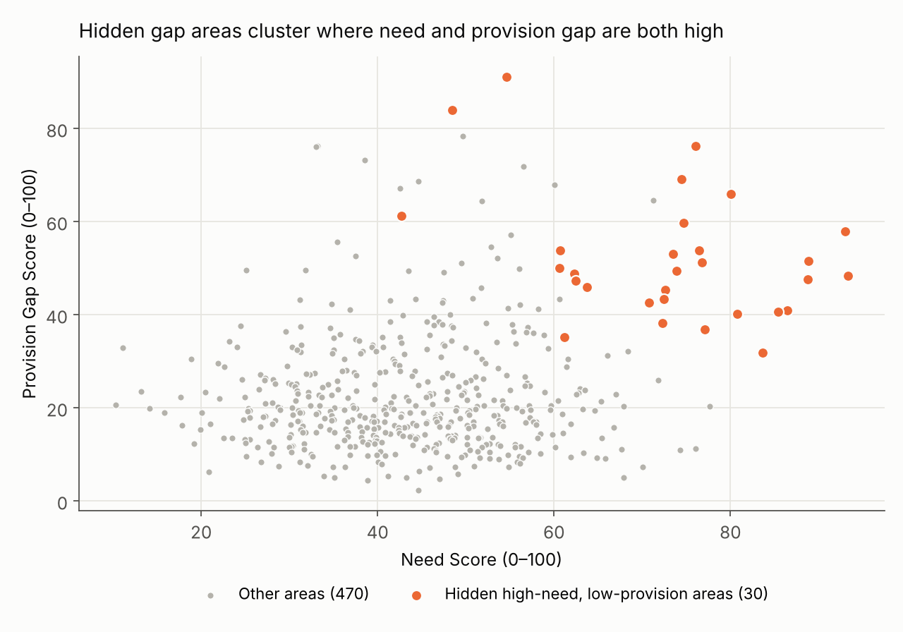
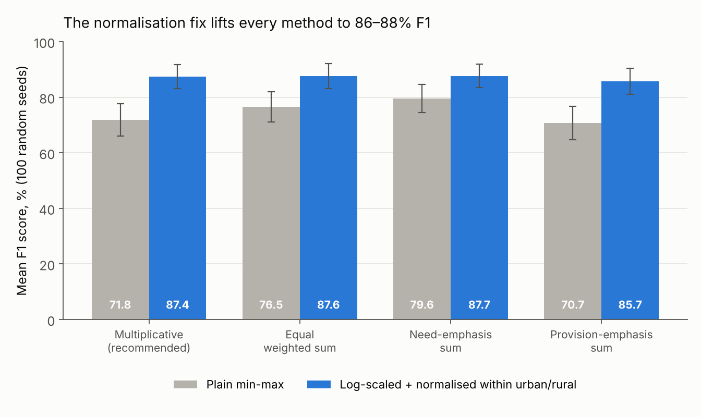
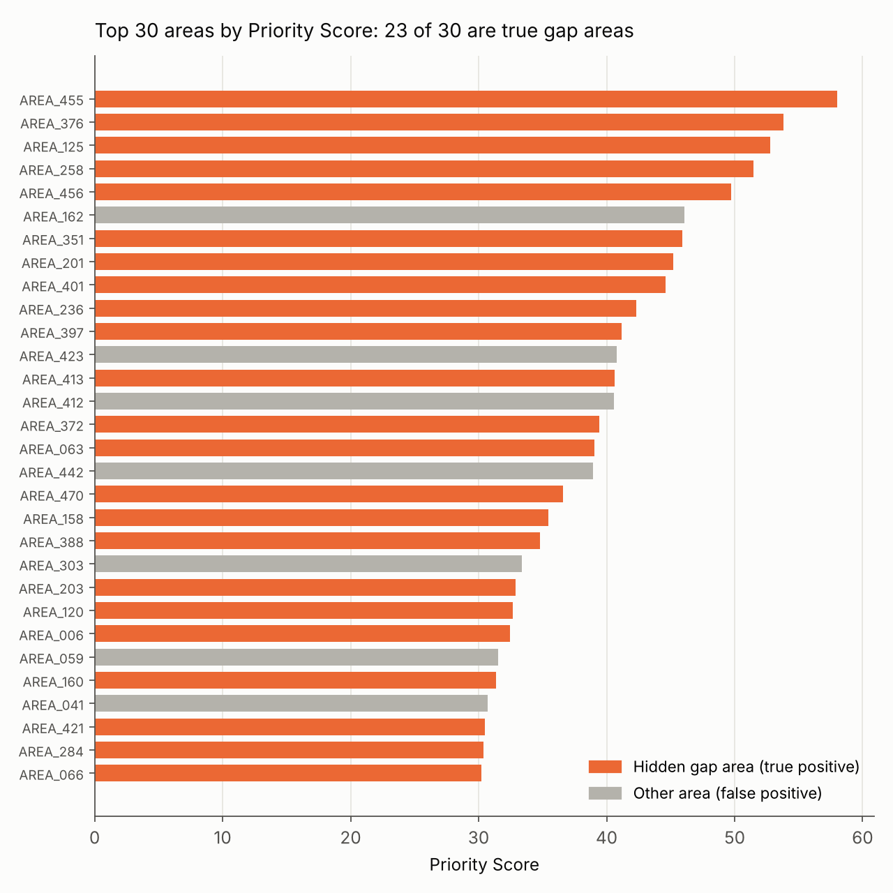

# Prioritising Unmet Primary Care Need in England

**A transparent, data-driven ranking system that flags areas where health need is high and GP provision is low.**
MSc Computer Science Independent Industry Project · Aston University · 2026



## The problem

Access to general practice in England has not kept pace with need. Areas with high health need often have relatively few GP services (the "inverse care law"). Planners, such as integrated care boards, need a simple, open way to compare need against provision across local areas.

Existing approaches either lean on a single indicator, such as deprivation alone, or use models that non-technical decision-makers can't easily follow or question. This project builds an **explainable** ranking that combines several indicators and is **tested against a known answer** before it would ever be used on real data.

## Key results

| Result | Value |
| --- | --- |
| Hidden gap areas found in the top-30 shortlist (baseline) | **23 of 30** (F1 76.7%, false-positive rate 1.5%) |
| Mean F1 over 100 random datasets, after the normalisation fix | **85.7–87.7%** for every weighted method (up from 70.7–79.6%) |
| Single-indicator ranking (e.g. patients per GP only) | 19.0% F1 — combining indicators is essential |
| Strict dual-threshold rule (both scores ≥ 60) | 16.1% F1 — too rigid |

**Main insight:** a few extreme values distorted plain min-max scaling. They pushed small rural areas with very few GPs up the ranking and pushed high-need urban areas down. **Log-scaling patients per GP and normalising within urban and rural groups** corrected most of this, and the gain held on held-out seeds.



## How it works

1. **Synthetic data:** 500 fictional local areas in England, generated in Python with realistic relationships, e.g. older and more deprived areas have more chronic illness. **30 high-need, low-provision areas are planted** and their labels are hidden during scoring, so the system can be checked against ground truth.
2. **Normalise** six indicators to a 0–100 scale.
3. **Score** each area:

   | Score | Indicators (baseline weights) |
   | --- | --- |
   | Need Score | Age 65+ (0.25), deprivation (0.30), chronic illness (0.30), population growth (0.15) |
   | Provision Gap Score | Patients per GP FTE (0.60), distance to nearest GP (0.40) |
   | **Priority Score** | Need Score × Provision Gap Score ÷ 100 |

4. **Rank** all areas and shortlist the top 30.
5. **Evaluate** against the hidden labels with precision, recall and F1. Then run sensitivity analysis on weights and shortlist size, compare five scoring methods, and repeat over 100 random seeds with a Wilcoxon signed-rank test.



## Files

| File | What it is |
| --- | --- |
| `ranking_system.py` | Data generation, scoring, evaluation and 100-seed robustness test |
| `make_figures.py` | Exports the dataset and results, and draws the charts |
| `synthetic_areas_seed42.csv` | The 500-area synthetic dataset (seed 42) |
| `top30_priority_areas.csv` | The top-30 shortlist from the baseline framework |
| `f1_100_seeds.csv` | Mean F1 ± SD for every method over 100 seeds |
| `*.png` | Charts used in this README |
| `requirements.txt` | Python packages needed |

## Run it

```bash
pip install -r requirements.txt
python ranking_system.py   # prints the baseline, method comparison and 100-seed results (~10 s)
python make_figures.py         # recreates the CSV files and charts
```

A fixed seed (42) reproduces every number above exactly.

## Tech stack

Python · pandas · NumPy · SciPy · Matplotlib · Jupyter Notebook

## Limitations and next steps

- **Synthetic data only.** No real patient or practice records were used. On a second generator with a weaker signal, the best method found only about half the target areas, so results depend on how clearly gaps stand out in the data.
- Weights were set from the literature, not agreed with stakeholders.
- **Next:** test on real, anonymised public data (NHS GP workforce, ONS population, Index of Multiple Deprivation at LSOA level), agree weights with planners, and add an interactive dashboard.

The ranking is designed to **support** professional judgement in early screening, not replace it.

## Author

**Manvitha Nampally** · MSc Computer Science, Aston University
[LinkedIn](https://www.linkedin.com/in/manvithanampally/) · [GitHub](https://github.com/nampallymanvitha123-hash)
